# ai-text-watermark



Invisible, key-verifiable watermarks for **AI / LLM text** — SynthID-Text style, in Rust + WebAssembly. **Generate**, **detect**, embed a **secret provenance message**, and run an **ultra-low-latency decode-loop proxy** — Node and browser.

This is a thin standalone wrapper that re-exports **[`@claude-flow/watermark`](https://www.npmjs.com/package/@claude-flow/watermark)** verbatim, so you get a memorable install name without any code duplication.

```bash
npm install ai-text-watermark
```

```js
const { Watermarker, detect } = require('ai-text-watermark');

// Stand-in for your model: 8 equally likely candidate token ids per step.
const wm = new Watermarker({ key: 'my-secret', scheme: 'gumbel' });
const out = [];
for (let i = 0; i < 200; i++) {
  const candidates = Array.from({ length: 8 }, (_, j) => (i * 31 + j * 7919) % 50000);
  out.push(candidates[wm.step(candidates, new Array(8).fill(1 / 8))]);
}
console.log(detect(out, { key: 'my-secret', scheme: 'gumbel' }).isWatermarked(1e-6)); // true
console.log(detect(out, { key: 'wrong-key', scheme: 'gumbel' }).isWatermarked(1e-6)); // false
```

In production, pass your model's real candidate token ids and probabilities to `wm.step()` at each decode step.

Browser / bundlers: `import { init, Watermarker, detect } from 'ai-text-watermark/web'; await init();`

Full docs, live playground, Rust crate (`ruflo-watermark`), and ADRs: **https://github.com/ruvnet/ai-text-watermark** · MIT © rUv
