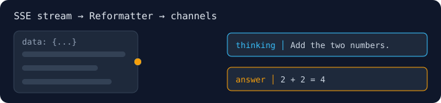

# llm-stream-reformat



Reformat a live LLM token stream **while it's still arriving** — separate a reasoning model's *thinking* from its *answer*, collapse repetition loops, and normalize whitespace. Parses **Google Vertex** (`gemini-3.7-flash`), **OpenRouter**, and **meta-llm** SSE.

Rust + WebAssembly, built on the real [`ruvnet/midstream`](https://github.com/ruvnet/midstream) `temporal-compare` primitive. Node + browser.

```bash
npm install llm-stream-reformat
```

```js
const { Reformatter } = require('llm-stream-reformat');

// Two SSE lines as Google Vertex streams them: one thought part, one answer part.
const sseLines = [
  'data: {"candidates":[{"content":{"parts":[{"text":"Add the two numbers.","thought":true}]}}]}',
  'data: {"candidates":[{"content":{"parts":[{"text":"2 + 2 = 4"}]}}]}',
];
const rf = new Reformatter();
for (const line of sseLines) {
  for (const ev of rf.pushSse('google', line)) console.log(ev.channel, JSON.stringify(ev.text));
}
for (const ev of rf.finish()) console.log(ev.channel, JSON.stringify(ev.text));
```

Prints `thinking "Add the two numbers."` then `answer "2 + 2 = 4"`. In production, feed each line of the provider's SSE response to `pushSse()` (`google`, `openrouter` or `metallm`).

Browser: `import { init, Reformatter } from 'llm-stream-reformat/web'; await init();`

Design: [ADR-390](https://github.com/ruvnet/ai-text-watermark/blob/main/docs/adr/ADR-390-inflight-stream-reformatting-midstream.md). MIT © rUv.
